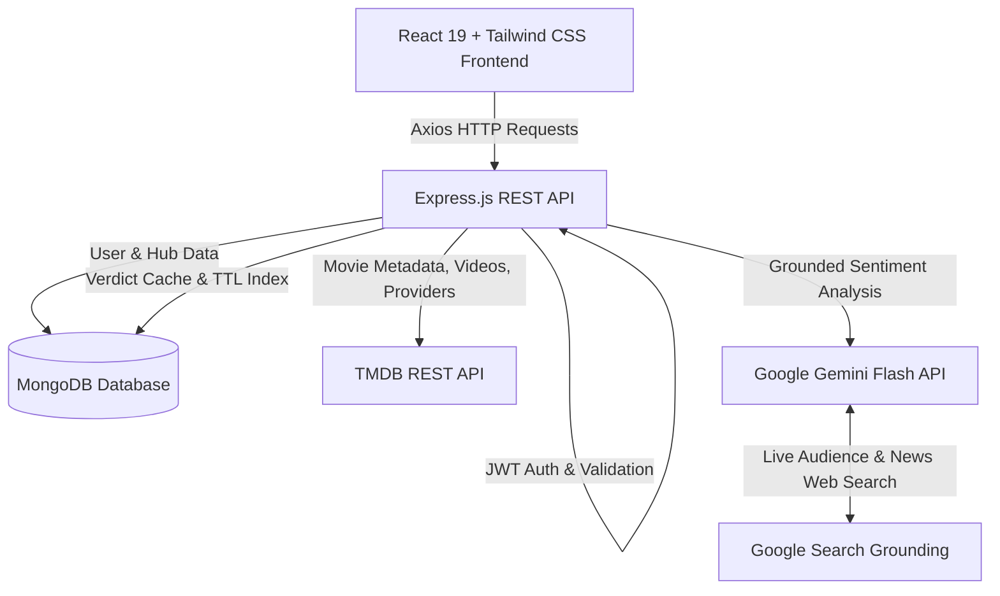

# CineScope 2.0

> **A Movie Discovery, Decision, and Intelligence Platform powered by MERN Stack and Google Gemini Grounded AI.**

CineScope 2.0 answers three critical questions for any film:
1. **Should I watch this movie?**
2. **Why is it worth watching or skipping?** (Audience consensus, strengths, and criticisms without spoilers)
3. **Where can I actually watch it in India?** (Indian OTT platform availability)

---

## 🌟 Key Features

### 1. Movie Discovery via TMDB
- Real-time movie search with debounced inputs and request cancellation for superseded queries.
- Trending and popular movie discovery with 7-minute in-memory server caching.
- In-depth movie metadata: synopsis, release year, runtime, ratings, cast, budget, revenue, and production studios.

### 2. Official Trailers & Clips
- Powered by TMDB Video API with official YouTube privacy-enhanced embeds (`youtube-nocookie.com`).
- Tabbed interface separating **Official Trailers** from **Teasers & Clips**.
- 16:9 responsive video player with fallback states when media is unavailable.

### 3. Gemini-Grounded Audience & News Pulse
- Solves the cold-start problem of empty user reviews on new platforms by analyzing publicly available web sentiment.
- Powered by **Google Gemini Flash API** (`gemini-3.5-flash-lite` / `gemini-3.8-flash`) via the official `@google/genai` SDK with **Google Search Grounding**.
- Analyzes authentic public sentiment across X (Twitter), Reddit, and entertainment news while filtering out bot spam, promotional hype, and plot spoilers.
- Provides an **Organic Sentiment Score (0–100)**, **Verdict Badge** (*Must Watch*, *Sleeper Hit*, *Mixed / Niche*, *Overhyped*, *Skip*), **Praised For** & **Criticized For** highlights, and verified citation sources.
- **MongoDB 24-hour TTL caching** prevents redundant AI calls and delivers near-instant repeat responses.
- In-process deduplication prevents concurrent requests from duplicating Gemini calls.
- Automatic graceful fallback if search grounding hits API rate limits.

### 4. Indian OTT Availability
- Powered by TMDB watch providers for the Indian region (`IN`).
- Covers **Subscription Streams**, **Free**, **Ad-Supported (AVOD)**, **Rent**, and **Buy** options with official platform logos.
- Direct search links to leading Indian streaming platforms:
  - **Netflix**
  - **Amazon Prime Video**
  - **JioHotstar / Disney+ Hotstar**
  - **JioCinema**
  - **SonyLIV**
  - **ZEE5**
  - **YouTube**
  - **Apple TV**
- **1-Click Direct Search Fallback**: Instant search toolbar for all major Indian OTT platforms when regional catalog indexing is delayed on TMDB/JustWatch.
- **International Streaming Indicator**: Displays whether the movie is already streaming in global regions (e.g. US) when Indian availability is pending.

### 5. Personal Cinema Hub
- JWT-authenticated personal library with dual states: **Want to Watch** and **Watched**.
- Post-viewing reaction tracking: **Worth It**, **Meh**, or **Skip**.
- **Taste Analytics**: Automatic genre frequency calculation highlighting the user's top preferences.
- **Recent AI Verdicts**: History tracking of the user's last 10 AI verdict lookups.

---

## 🏗️ Architecture



---

## 🛠️ Technology Stack

| Layer | Technology |
|---|---|
| **Frontend** | React 19, Tailwind CSS 4, Vite 7, React Router 7, Axios, Lucide Icons, React Hot Toast |
| **Backend** | Node.js, Express.js 4, MongoDB, Mongoose 8, JWT, bcryptjs, express-rate-limit, express-validator |
| **AI & Grounding** | Google Gemini API (`@google/genai`), Google Search Grounding tool |
| **External APIs** | The Movie Database (TMDB) API |
| **Testing** | Jest, Supertest, MongoDB Memory Server |

---

## 📡 REST API Reference

### Authentication
| Method | Endpoint | Auth | Description |
|---|---|---|---|
| `POST` | `/api/auth/register` | Public | Register a new user account |
| `POST` | `/api/auth/login` | Public | Authenticate user and receive 1-hour JWT |

### Movies & Discovery
| Method | Endpoint | Auth | Description |
|---|---|---|---|
| `GET` | `/api/movies/search?query=...` | Public | Search movies by title on TMDB |
| `GET` | `/api/movies/popular` | Public | Get popular movies (7-min server cache) |
| `GET` | `/api/movies/details/:id` | Public | Get movie details, cast, and metadata |
| `GET` | `/api/movies/cache-stats` | Public | Get in-memory cache hit/miss statistics |
| `GET` | `/api/movies/:id/videos` | Public | Get trailers and clips filtered for YouTube |
| `GET` | `/api/movies/:id/providers?title=...` | Public | Get Indian OTT streaming providers and search links |
| `GET` | `/api/movies/:id/verdict?title=...&year=...` | Optional JWT | Get or generate Gemini-grounded audience verdict |

### Personal Cinema Hub
| Method | Endpoint | Auth | Description |
|---|---|---|---|
| `GET` | `/api/user/hub` | Bearer JWT | Fetch user library, taste analytics, and recent verdict history |
| `POST` | `/api/user/movies` | Bearer JWT | Add or update a movie in user's library |
| `PATCH` | `/api/user/movies/:tmdbId` | Bearer JWT | Update status (`want_to_watch`/`watched`) or personal reaction |
| `DELETE` | `/api/user/movies/:tmdbId` | Bearer JWT | Remove a movie from personal library |
| `GET` | `/api/movies/watchlist` | Bearer JWT | Legacy watchlist fetch |
| `POST` | `/api/movies/watchlist` | Bearer JWT | Legacy watchlist add |
| `DELETE` | `/api/movies/watchlist/:id` | Bearer JWT | Legacy watchlist remove |

---

## 🚀 Getting Started

### Prerequisites
- **Node.js** (v18 or higher)
- **MongoDB** (local community server or MongoDB Atlas URI)
- **TMDB API Key** ([themoviedb.org](https://www.themoviedb.org/documentation/api))
- **Google Gemini API Key** ([aistudio.google.com](https://aistudio.google.com/))

---

### Installation & Setup

#### 1. Clone the repository
```bash
git clone https://github.com/your-username/cinescope.git
cd cinescope
```

#### 2. Backend Configuration
Create `backend/.env` based on `backend/.env.example`:
```env
PORT=5000
MONGODB_URI=mongodb://127.0.0.1:27017/cinescope
JWT_SECRET=your-secure-random-jwt-secret
TMDB_API_KEY=your-tmdb-api-key
GEMINI_API_KEY=your-google-gemini-api-key
GEMINI_MODEL=gemini-3.5-flash-lite
```

Install backend dependencies and start development server:
```bash
cd backend
npm install
npm run dev
```

#### 3. Frontend Configuration
Create `frontend/.env` based on `frontend/.env.example`:
```env
VITE_API_BASE_URL=http://localhost:5000/api
```

Install frontend dependencies and start Vite dev server:
```bash
cd ../frontend
npm install
npm run dev
```

The frontend will run at `http://localhost:5173` and the backend will run at `http://localhost:5000`.

---

## 🧪 Running Tests

The backend test suite includes integration tests using `mongodb-memory-server` and mocked external services.

```bash
cd backend
npm test
```

To run frontend build checks:
```bash
cd frontend
npm run build
```

---

## 📄 License
This project is open-source and available under the MIT License.
