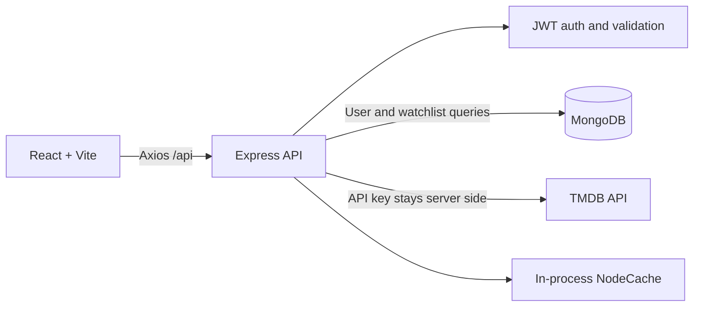
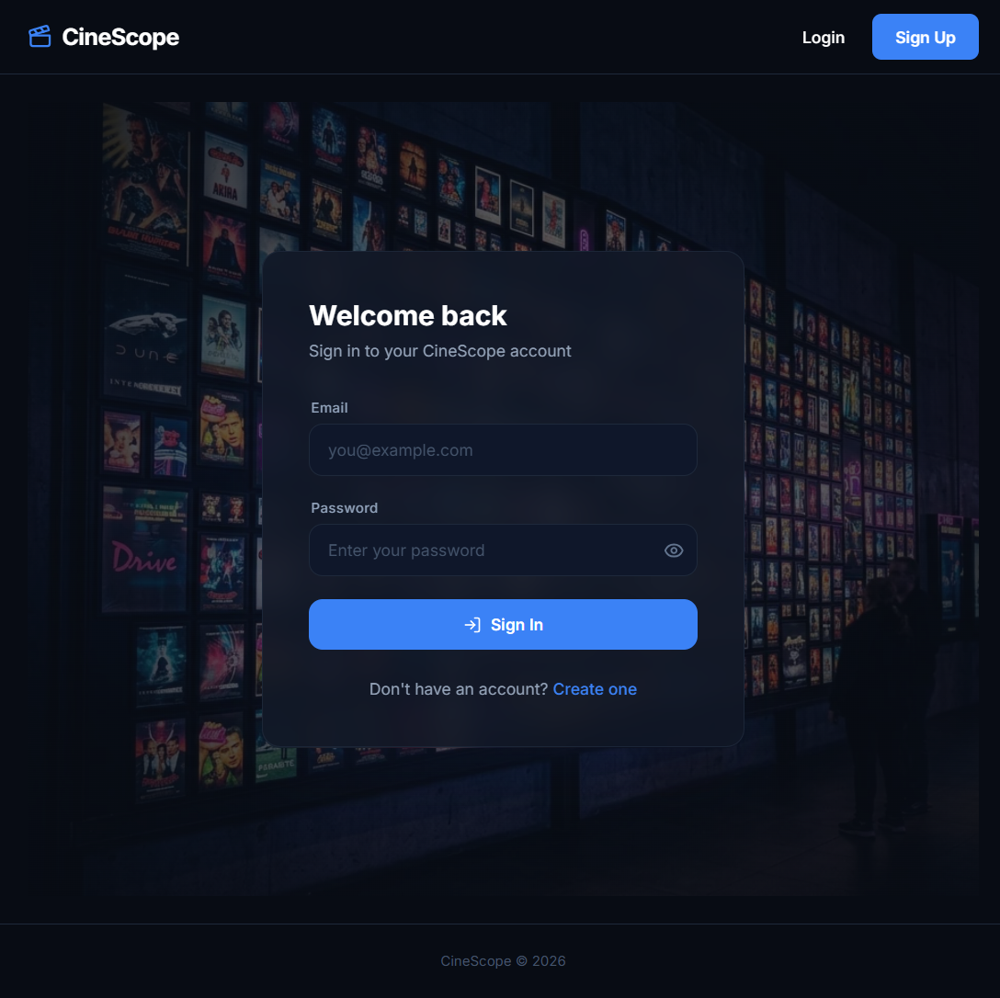
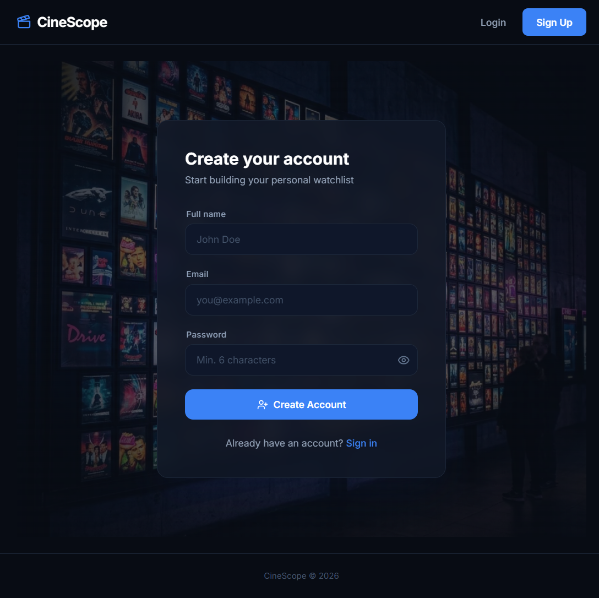

# CineScope

CineScope is a movie discovery and personal watchlist app. Users can register, browse popular titles, search TMDB, view movie details and trailers, and save or remove movies from a private watchlist.

## Features

- Email/password registration and login with bcrypt password hashing and one-hour JWTs.
- Protected React routes and per-user watchlist operations.
- TMDB search, popular movies, and details through the backend proxy.
- Seven-minute in-memory caching for popular and details responses.
- Debounced search with cancellation of superseded browser requests.
- Duplicate watchlist protection with a MongoDB compound unique index.

## Stack

React 19, Vite 7, Tailwind CSS 4, Axios, Node.js, Express 4, Mongoose 8, MongoDB, TMDB API, Jest, Supertest, and `mongodb-memory-server`.

## Architecture



See [Architecture](docs/ARCHITECTURE.md) for request flows, data/index details, security decisions, and trade-offs. [Interview Guide](docs/INTERVIEW_GUIDE.md) contains source-grounded questions and walkthroughs.

## Live demo and screenshots

Try the [CineScope live demo](https://cinescope-1-kmoz.onrender.com/). The frontend and backend are hosted on Render; the backend health check is available at <https://cinescope-8m6a.onrender.com/>.

### Sign in



### Create an account



## Setup

Requirements: Node.js 20 or newer, npm, MongoDB, and a TMDB API key.

Create `backend/.env` from [`backend/.env.example`](backend/.env.example) and `frontend/.env` from [`frontend/.env.example`](frontend/.env.example). Fill in local values; never commit either `.env` file. `VITE_API_BASE_URL` is public frontend configuration and must point to the backend. `TMDB_API_KEY`, `JWT_SECRET`, and `MONGODB_URI` belong only in the backend environment.

```powershell
cd backend
npm ci
npm run dev
```

In another terminal:

```powershell
cd frontend
npm ci
npm run dev
```

The backend defaults to port `5000`; Vite defaults to `5173`. MongoDB must be running and reachable through `MONGODB_URI`.

## API

| Method | Path | Auth | Purpose |
|---|---|---|---|
| POST | `/api/auth/register` | No | Create account; returns token and user |
| POST | `/api/auth/login` | No | Sign in; returns token and user |
| GET | `/api/movies/search?query=...` | No | Search TMDB |
| GET | `/api/movies/popular` | No | Popular TMDB titles (cached) |
| GET | `/api/movies/details/:id` | No | Movie details, credits, and videos (cached) |
| GET | `/api/movies/watchlist` | Bearer token | List the signed-in user's saved movies |
| POST | `/api/movies/watchlist` | Bearer token | Add a movie; duplicate is `409` |
| DELETE | `/api/movies/watchlist/:id` | Bearer token | Remove a movie by TMDB ID |
| GET | `/api/movies/cache-stats` | No | Process-local cache hit/miss counters |

Successful response bodies are JSON. Auth validation errors use `400`, invalid credentials/tokens use `401`, duplicate registration/watchlist entries use `409`, upstream movie service failures use `502` or `504`, and unexpected database failures use `500` with a safe message.

## Checks and benchmark

```powershell
cd backend
npm test
```

```powershell
cd frontend
npm run lint
npm run build
```

The backend tests use an in-memory MongoDB binary and do not require your application database. CI runs backend tests and the frontend lint/build.

`backend/benchmark.js` compares MongoDB `explain('executionStats')` with and without the watchlist compound index. It temporarily drops and recreates that index. Run it only against a disposable benchmark database with seeded documents, never against production or a database where index state must not be changed. `backend/seed.js --clean` deletes the `movies` and `users` collections in its configured database; use a disposable database only. See [Architecture: index evidence](docs/ARCHITECTURE.md#database-index-and-complexity).

## Limitations and next steps

The cache is local to one Node process and is lost on restart. Search responses are not cached. JWTs are stored in browser local storage, so an XSS vulnerability could expose them. CORS currently allows all origins. Cache statistics are process-local and unauthenticated. These choices keep the student project small; a deployed version should configure allowed origins, use a safer token/session strategy, and use shared cache/metrics if it runs on multiple instances.

Possible next steps include pagination, stronger field validation, account recovery, browser-level tests, and documenting the managed database and secrets configuration used by the live deployment.
