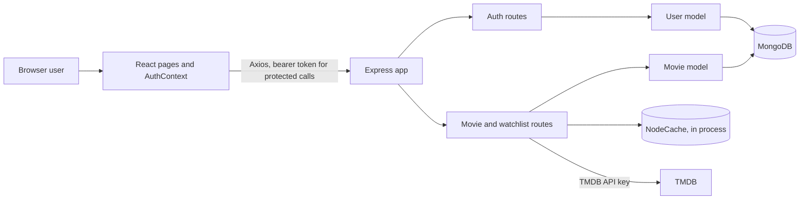

# CineScope architecture

## System view

## Repository map

| Path | Responsibility |
|---|---|
| `backend/app.js` | Builds Express middleware and mounts routers without starting a listener, so Supertest can exercise the app. |
| `backend/server.js` | Loads environment variables, connects Mongoose, then starts the HTTP listener. |
| `backend/routes/auth.js` | Registration, login, validation, password hashing, token creation, and login rate limit. |
| `backend/routes/movies.js` | TMDB proxy, retry/cache behavior, and watchlist HTTP operations. |
| `backend/middleware/authMiddleware.js` | Reads and verifies bearer JWTs and supplies `req.user`. |
| `backend/models/User.js` | User schema and unique normalized email index. |
| `backend/models/Movie.js` | Watchlist document schema and per-user/movie unique index. |
| `backend/__tests__` | HTTP integration tests using Supertest and an in-memory MongoDB server. |
| `backend/benchmark.js`, `backend/seed.js` | Index explain comparison and sample-data creation. Both require a disposable database. |
| `frontend/src/utils/api.js` | Shared Axios instance; token attachment and logout on protected 401s. |
| `frontend/src/context` | Auth state and initialization from persisted user/token values. |
| `frontend/src/pages` | Login, registration, discovery/search, details, and watchlist screens. |
| `frontend/src/components` | Reused navigation, movie card, and trailer UI. |

## Registration and login

1. The client submits email/password (and name for registration) to `/api/auth/register` or `/api/auth/login`.
2. `express-validator` trims the name, normalizes and checks email, and checks the registration password has at least six characters. Login is limited to ten attempts per IP in a 15-minute window.
3. Registration hashes the password with bcryptjs using cost 10. The login flow compares it against the stored hash. The raw password is not returned.
4. `User.email` is unique in MongoDB. Registration checks for a friendly existing-account response, then catches duplicate-key error `11000` as `409` as well, which handles concurrent requests safely.
5. The API signs `{ id }` into a JWT with a one-hour expiry and returns `{ token, user }`.

## Authentication and authorization

On startup, AuthContext reads the stored user and checks only whether the token has a future `exp` claim. This is a UI convenience, not verification: the backend verifies the token signature with `JWT_SECRET` for every protected route. The Axios request interceptor sends `Authorization: Bearer <token>`. Invalid/expired tokens return `401`; its response interceptor clears persisted credentials and redirects for non-auth API calls.

After middleware verification, `req.user` is the signed token's user ID. All watchlist reads, inserts, and deletes include that ID. Deletion by another user therefore matches no document and cannot remove someone else's item.

## Watchlist operations and duplicate prevention

- `GET /api/movies/watchlist` queries `{ userId: req.user }`.
- `POST /api/movies/watchlist` validates required schema fields through Mongoose and inserts the movie metadata with the authenticated ID. It returns `201`; invalid Mongoose movie data returns `400`; duplicate key error `11000` returns `409`.
- `DELETE /api/movies/watchlist/:id` deletes by both `{ userId: req.user, tmdbId: id }` and returns the existing success message even if no matching movie exists.

The unique compound index `{ userId: 1, tmdbId: 1 }` makes a movie unique within one user's list while allowing different users to save it. It is a correctness constraint under concurrent inserts, not just a query optimization. A point lookup can use the index in approximately `O(log N)` B-tree traversal and return a small number of matching entries; the list query on `userId` can use the compound index's leftmost prefix. Exact performance depends on data size, selectivity, MongoDB, and workload. No benchmark result is claimed here. `backend/benchmark.js` prints `docsExamined`, `keysExamined`, and execution time for the current configured database; run only against a disposable seeded database because it temporarily drops the compound index.

## TMDB proxy, caching, retries, and search

The browser calls Express, which adds `TMDB_API_KEY` to server-side Axios parameters. The key is never included in frontend code or responses. Search uses Axios' `params` object for URL encoding. TMDB popular and detail responses use a `node-cache` process-local cache with a seven-minute TTL; search is not cached. `/api/movies/cache-stats` exposes process-local hit/miss counters.

`tmdbGet` uses an eight-second Axios timeout. It makes at most three total attempts (the initial request and two retries) for HTTP 429 and 5xx responses, waiting 500 ms and then 1,000 ms between attempts. Other errors, including timeout errors, are not retried. The route returns `504` for Axios timeout and `502` for other upstream failures, with safe client messages and server-side logs. Search rejects an empty query and detail/watchlist paths reject non-positive or non-numeric movie IDs with `400`.

The Home page debounces nonempty queries by 300 ms. Each query effect owns an `AbortController`; changing or clearing the query clears the pending timer and aborts its previous request. A request ID ensures only the latest request can update results/loading state. Clearing the field fetches popular movies again. Browser cancellation does not cancel a TMDB call already running on Express.

## Errors and security

- Registration/login validation returns `400`; bad credentials and invalid tokens return `401`; duplicates return `409`.
- Unexpected backend/database failures are logged on the server and use safe response messages. Upstream TMDB errors use `502` or `504`. Protected middleware returns `500` if `JWT_SECRET` is missing from server configuration, and `401` for invalid/expired tokens when configured.
- Passwords use bcrypt hashes; JWTs expire after one hour. Login has an IP-based rate limit.
- Mongoose user and watchlist ownership is derived from the verified token, not client-supplied user IDs.
- The TMDB key stays server-side. `.env` files are ignored by Git; `.env.example` files contain placeholders only.
- Current limitations: CORS permits all origins; JWTs are held in local storage; cache and rate-limit state are per process; cache-stats is public; there is no registration limiter or explicit request-size bound beyond Express JSON defaults and the current validators. Production deployment should set a narrow CORS origin and review token storage, shared rate limiting, and validation.

## Trade-offs

- **React Context:** Auth changes infrequently, so a built-in context avoids an extra state library. Page data stays local to each screen.
- **JWT in local storage:** Simple for a learning project and easy to send as a bearer token; an XSS bug could read it. HttpOnly secure cookies with CSRF protections are a common alternative.
- **Process-local cache:** Simple and low-latency for one instance; multiple backend processes do not share entries. Redis or HTTP caching is an option if deployment needs shared cache state.
- **Movie metadata copied into watchlist documents:** Allows the list to render without another TMDB request per item. Stored title/poster details can become stale.
- **MongoDB compound unique index:** Enforces the key product invariant under concurrency and supports per-user list queries. A relational database with a unique constraint on `(user_id, tmdb_id)` would also fit this relationship.

## Local verification

Run `npm test` under `backend`, then `npm run lint` and `npm run build` under `frontend`. Tests use an in-memory MongoDB server; benchmark and seed commands use `MONGODB_URI` and can modify database/index state. `server.js` waits for MongoDB to connect before opening the HTTP listener; a failed initial connection prevents the API from advertising itself as ready.
